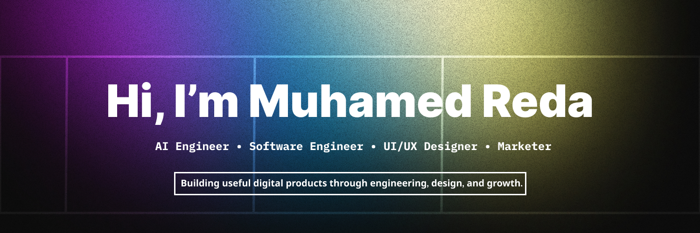

  

# 👨‍💻 About Me

I'm a developer and digital product builder from Morocco interested in the intersection of **technology, design, and business**.

My work is mainly focused on four areas:

* 🎨 **UI/UX Design** — designing clean, modern, and intuitive interfaces
* 📈 **Marketing** — understanding products, positioning, content, audience, and growth
* 🤖 **AI Engineering** — building AI-powered systems and integrating modern AI technologies
* 💻 **Software Engineering** — developing reliable, scalable, and maintainable applications

I also work with:

* 🚀 AI SaaS & product development
* 🖌️ Graphic Design
* 🎬 Video Editing
* 🌍 French • English • Arabic

I enjoy taking an idea from **concept → design → development → launch → improvement**.

---

# 🎯 Core Skills

<table>
<tr>
<td width="25%" align="center">

### 🎨 UI/UX

Design systems
User interfaces
User experience
Wireframing
Prototyping
Responsive design

</td>

<td width="25%" align="center">

### 📈 Marketing

Product positioning
Content strategy
Audience research
Growth concepts
Brand communication
Product marketing

</td>

<td width="25%" align="center">

### 🤖 AI Engineering

LLM applications
AI integration
Machine Learning
Computer Vision
AI workflows
AI APIs

</td>

<td width="25%" align="center">

### 💻 Software Engineering

Backend development
Frontend development
APIs
Databases
System architecture
DevOps

</td>
</tr>
</table>

---

# ⚡ Technologies

  
  
  
  
  
  
  
  
  
  
  
  

# 🚀 Building

I like building projects where **engineering, design, and business meet**.

My approach is simple:

> **Understand the problem → Design the experience → Build the system → Launch → Learn → Improve**

Rather than focusing on technology alone, I care about whether a product is:

* Useful
* Easy to understand
* Well designed
* Technically solid
* Easy to scale
* Able to reach the right audience

---

# 💡 Philosophy

> **Build. Design. Learn. Improve.**

I believe the strongest products come from combining **good engineering, good design, and a clear understanding of people and markets.**

---

# 🌐 Connect

---

  <strong>AI Engineering • Software Engineering • UI/UX • Marketing</strong>

  <i>Turning ideas into useful digital products.</i>

